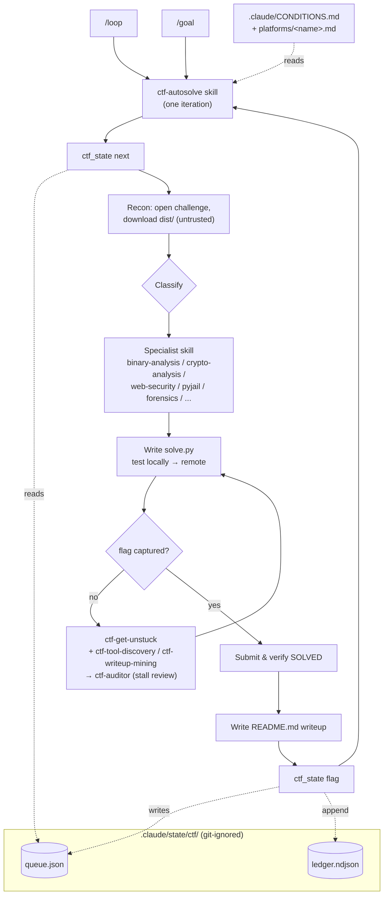

# CTF Learning Workspace


Workspace for learning CTF (Capture The Flag) challenges, centered on an
**autonomous solving harness** that works on any CTF/platform. Build security
skills while having fun solving challenges.

## Autonomous harness (the main event)

A self-driving loop solves challenges end-to-end — recon → solve → submit →
verify → writeup → record — one at a time, tracking state in a queue + decision
ledger. Per competition you edit **one file** (`.claude/CONDITIONS.md`) and point
it at a **platform profile** (`.claude/skills/ctf-autosolve/platforms/<name>.md`;
AlpacaHack ships as the first). Full docs: **[`HARNESS.md`](./HARNESS.md)**.

**Run it** (two built-in drivers over the `ctf-autosolve` skill):

| You want | Command |
|----------|---------|
| Keep solving until done (self-paced loop) | `/loop use the ctf-autosolve skill to solve the next challenge` |
| Keep going until a goal is met | `/goal <your goal>` (release early with `/goal clear`) |
| Solve one challenge | invoke the `ctf-autosolve` skill |
| Progress | `python3 -I .claude/skills/ctf-autosolve/scripts/ctf_state.py summary` |

New event? Copy `platforms/_template.md`, fill it, set `.claude/CONDITIONS.md`,
then run the loop. The harness obeys each competition's own rules (AI use,
automation, writeup timing) and only touches authorized, in-scope targets.

## Quick Start

```bash
# Wizard classifies the challenge; then invoke the matching specialist skill
/solve <challenge>

# Documentation
/writeup <challenge-name>   # Generate solution writeup
/ctftime                    # Find upcoming CTF competitions
```

For full automation, drive the `ctf-autosolve` skill with `/loop` or `/goal`
(see the harness section above / `HARNESS.md`). Per-category work is handled by
the specialist skills (binary-analysis, crypto-analysis, web-security, pyjail,
forensics, networking, mobile-security, osint) — no separate commands needed.

## Output Styles

```bash
/output-style ctf-focused   # Direct, exploit-first approach
/output-style ctf-beginner  # Step-by-step learning mode with explanations
```

## How the harness works

The autonomous harness is three parts: **drivers** (the built-in `/loop` and
`/goal`), the **`ctf-autosolve` skill** (one challenge per iteration), and
**JSON state** the skill reads/writes via `ctf_state.py` — `queue.json` (status
per challenge) and `ledger.ndjson` (append-only decision log). Per competition,
`.claude/CONDITIONS.md` + a `platforms/<name>.md` profile supply the *what* and
*how*; specialist and meta skills do the solving; `ctf-auditor` reviews stalls.



Drive it with `/loop …` or `/goal …` (see [Autonomous harness](#autonomous-harness-the-main-event) above and [`HARNESS.md`](./HARNESS.md)). The conversation is disposable — the queue + ledger + per-challenge `README.md` are the durable memory, so a run resumes after compaction by re-reading `ctf_state summary` and `CONDITIONS.md`.

## Claude Code Agents

| Agent | Description |
|-------|-------------|
| **wizard** | Primary intake agent. Classifies challenges and routes to appropriate skill. |
| **hint-helper** | Progressive hint provider for beginners learning to solve independently. |

### Wizard Routing Table

| Category | Skill | Key Indicators |
|----------|-------|----------------|
| pwn | binary-analysis | ELF + remote service, dangerous functions |
| rev | binary-analysis | Binary asking for key/password, no remote |
| web | web-security | URL, HTTP service, web framework source |
| crypto | crypto-analysis | Large numbers (n, e, c), encryption script |
| forensics | forensics | Image/audio, memory dump, disk image |
| misc | pyjail | Python jail, encoding puzzle, esoteric |
| osint | osint | Username search, image geolocation |
| mobile | mobile-security | APK/IPA file |
| networking | networking | PCAP file, traffic analysis |

## Skills Reference

**Specialist** (the actual solving, per category):

| Skill | Capabilities |
|-------|--------------|
| **binary-analysis** | checksec, ROP, format string, heap, cwe_checker |
| **crypto-analysis** | Ciphey auto-decrypt, RSA attacks, AES, lattice, xortool |
| **forensics** | stego, binwalk, Volatility, AperiSolve, DeepSound |
| **web-security** | SQLi, XSS, SSTI, SSRF, command injection, deserialize |
| **networking** | tshark, Wireshark, PCAP analysis, protocol extraction |
| **mobile-security** | jadx, Frida, objection, APK/IPA analysis |
| **osint** | sherlock, geolocation, archives, social media |
| **pyjail** | Python sandbox escape, restricted shell bypass |
| **writeup** | Solution documentation generation |

**Harness & meta** (automation + how to get unstuck):

| Skill | Role |
|-------|------|
| **ctf-autosolve** | One autonomous iteration: recon → solve → submit → writeup → record (queue + ledger) |
| **ctf-get-unstuck** | Escalation ladder when stuck: re-read → abstract → lateral/wild ideas → learn from top players (EN/JA) |
| **ctf-tool-discovery** | Find/choose the right tool for an unfamiliar artifact; search EN/JA; install safely |
| **ctf-writeup-mining** | Mine prior writeups (CTFtime, top blogs, EN/JA); technique-only for ACTIVE, full solve only when ENDED |

## Directory Structure

```
challenges/                      # CTF challenges by platform
├── alpacahack/                  # AlpacaHack
│   ├── daily/                   # Daily challenges (YYYY-MM-DD_name/)
│   └── contests/                # Contest challenges (YYYY-MM_event/)
├── picoctf/                     # picoCTF (by year)
├── hackthebox/                  # HackTheBox
│   ├── challenges/              # Standalone challenges
│   └── machines/                # Machine writeups
└── ctftime/                     # CTFtime competitions

.claude/                         # Claude Code configuration
├── agents/                      # wizard, hint-helper, ctf-auditor
├── commands/                    # /solve, /writeup, /ctftime
├── skills/                      # specialist skills + ctf-autosolve (harness)
├── output-styles/               # ctf-focused, ctf-beginner
└── rules/                       # guidelines, policies, harness rules
```

### Challenge Directory Structure

```
challenge-name/
├── README.md        # Writeup (tracked)
├── solve.py         # Solution script (tracked)
├── dist/            # Distributed files (ignored)
└── work/            # Working files (ignored)
```

## Flag Formats

Flag format varies by platform:
```
picoCTF{...}     - picoCTF
HTB{...}         - HackTheBox
THM{...}         - TryHackMe
Alpaca{...}      - AlpacaHack
TSGLIVE{...}     - TSGLIVE
flag{...}        - Common format
CTF{...}         - Generic CTF
```
